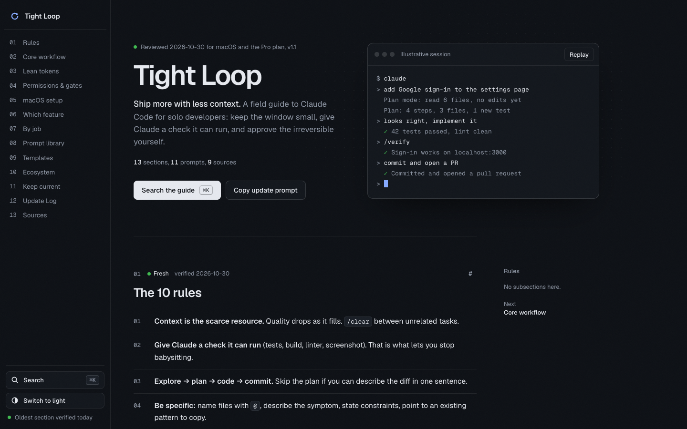

# Tight Loop

A lean field guide to Claude Code for solo developers on the Pro plan: the core loop, saving tokens, permission gates, a prompt library and copy-paste templates.

**Live:** https://hhrishikeshh.github.io/ClaudeCodeGuide/

## What's inside

- The 10 rules, the core workflow (explore, plan, implement, verify, commit) and lean token habits
- Permission modes and an ask-first list for anything irreversible
- 11 copy-ready prompts, CLAUDE.md, skill and subagent templates
- Search everything with <kbd>⌘K</kbd> (or <kbd>/</kbd>); press <kbd>?</kbd> for shortcuts

It's one self-contained file, `index.html`, with no build step. Open it locally or serve the repo root.

## Keeping it current

Every section has a `data-v` date and a visible "verified" stamp. The page shows how fresh each section is and the age of the oldest one.

1. Open Claude chat with web search on and attach `index.html`.
2. Paste the audit prompt from the "Keep this guide current" section (the **Copy update prompt** button at the top copies it).
3. If it reports major changes, it gives you an edit prompt. Run that in Claude Code from this folder, review `git diff`, then commit.

Section counts, navigation, search and freshness are all read from the page, so content edits need no script changes.

## Deploy

Pushes to `main` deploy through `.github/workflows/astro.yml` (a plain static Pages upload of the repo root). In the repo settings, set **Pages → Source** to **GitHub Actions**.

## License

MIT © 2026 Hrishikesh Kalekinge. Not affiliated with Anthropic.
